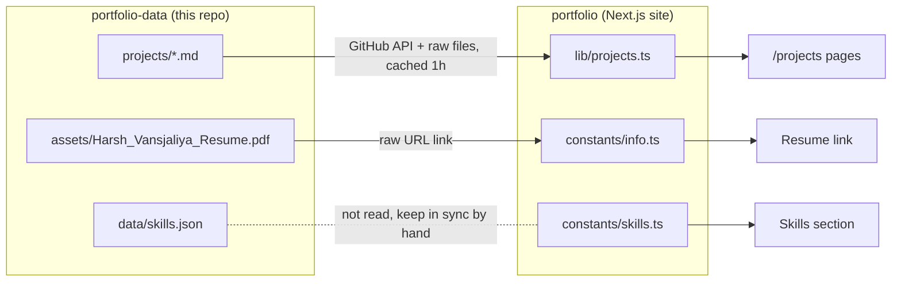

# portfolio-data

Content for [harshvansjaliya.com](https://harshvansjaliya.com). The site ([portfolio](https://github.com/Harsh6575/portfolio)) fetches these files from GitHub at request time, so content changes go live without redeploying the site.

## Layout

```
portfolio-data/
├── projects/        one Markdown file per project, read by the site
├── data/
│   └── skills.json  skills list (mirror of the site's constants, see below)
└── assets/
    └── Harsh_Vansjaliya_Resume.pdf   linked from the site as the resume
```

## How the site reads it



| File | Read by | How |
|---|---|---|
| `projects/*.md` | `lib/projects.ts` | Lists the folder through the GitHub contents API, fetches each file from `raw.githubusercontent.com`, and parses it with `gray-matter` |
| `assets/Harsh_Vansjaliya_Resume.pdf` | `constants/info.ts` | Linked directly by its raw URL |
| `data/skills.json` | nothing yet | `lib/content.ts` can fetch it, but the site renders skills from `constants/skills.ts`; keep the two in sync |

Responses are cached for an hour (`revalidate: 3600`), so an update shows up on the site within about an hour of pushing to `main`.

## Project files

Each file in `projects/` is front matter followed by the long-form write-up shown on the project's page.

| Field | Type | Notes |
|---|---|---|
| `title` | string | Shown in the project list and as the page heading; text after ` - ` becomes the page subtitle |
| `slug` | string | URL path (`/projects/<slug>`); defaults to the file name |
| `description` | string | One short sentence, shown under the title in the project list |
| `category` | string | e.g. `Full-Stack`, `Backend`, `FinTech` |
| `status` | string | e.g. `Completed`, `In Progress`, `Professional Project` |
| `date` | string | e.g. `"Nov 2025 - May 2026"` |
| `technologies` | string[] | Shown on the project page, grouped by layer (frontend, backend, data, infra) |
| `features` | string[] | Not shown on the site at the moment; keep for the write-up's own reference |
| `links` | `{ type, label, url }[]` | `type` is `github` or `live`; use `[]` for none |
| `order` | number | Sort order, lowest first |
| `hidden` | boolean | `true` keeps the file but hides the project |

Body sections used so far: an intro paragraph, `## How It Works`, `## Key Highlights`, `## Tech Stack`.

Diagrams go in fenced ` ```mermaid ` blocks. The site renders them with mermaid's dark theme, and so does GitHub. Each diagram follows the same rule as the text: draw only what the code does.

**Rule:** a project file only claims what that project's code does, so a reader can check it against the repo. Experience from jobs belongs on the site's experience section and in the skills list.

## Current projects

| File | Project | Status | Order |
|---|---|---|---|
| `tailor-track.md` | Tailor Track | In Progress | 1 |
| `cooked.md` | cooked | Completed | 2 |
| `margin.md` | Margin | Completed | 3 |
| `invoxa.md` | Invoxa | In Progress | 4 |
| `shortify.md` | Shortify | Completed | 5 |
| `algorithmic-trading-platform.md` | Algorithmic Trading Platform | Professional Project | 6 |
| `hotel-reservation-platform.md` | Hotel Reservation Platform (Airbnb-style) | Completed | 7 |
| `messenger-clone.md` | Messenger Clone | Completed | 8 |
| `spotify-clone.md` | Spotify Clone | Completed | 9 |

## Skills file

`data/skills.json` mirrors `constants/skills.ts`: `coreStack` is the four short lines the skills section shows (`layer` and `items`), and `skills` is the full list behind its "Show everything I've used" toggle, each with `category`, `period`, `description`, `items` and `priority`. Plus `metadata.lastUpdated`.

## Adding or changing content

- **New project:** add `projects/<slug>.md` with the fields above and pick an `order`.
- **Hide a project:** set `hidden: true`. **Remove it:** delete the file.
- **Skills:** edit `constants/skills.ts` in the portfolio repo (that's what renders), then mirror the change here.
- **Resume:** replace the PDF and keep the same file name, or the site link breaks.

Commits follow `content(projects): ...`, `content(skills): ...` and `docs: ...`.
