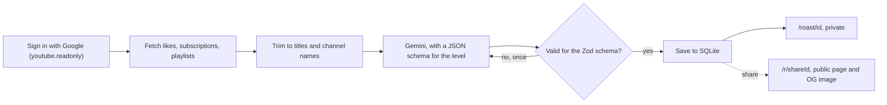

cooked reads your liked videos, subscriptions and playlists from YouTube and has Gemini roast you for them, at an intensity you choose. The roast is the fun part; the reason for building it was to ship the pieces behind most "Sign in with Google" products end to end: OAuth with a sensitive scope, a quota-limited external API, and LLM output that has to be checked instead of trusted.

## How It Works

- Sign-in uses NextAuth with Google's `youtube.readonly` scope. The Google tokens stay inside the encrypted session cookie, and the access token is refreshed from the refresh token a minute before it expires.
- The YouTube Data API is paged 50 items at a time, and each page costs quota, so the snapshot is capped (100 liked videos, 200 subscriptions, 50 playlists) and cut down to titles and channel names before it goes anywhere. A Google account with no channel answers 404 for its own subscriptions, which the app reads as "none" rather than an error.
- Gemini gets the snapshot between markers with an instruction to treat it as data, since video titles are written by strangers. It returns JSON for a schema generated from the same Zod schema that validates the answer: a 0 to 100 brain rot score, an archetype, a short personality read, the roast and three to five red flags.
- Invalid JSON or a safety block gets one retry. If the main model is overloaded (429, a 5xx or a timeout), the app switches to a lighter fallback model instead of waiting on SDK retries, which once kept a roast spinning for almost five minutes.
- Each user can make 5 roasts an hour, since every roast costs Gemini quota.
- SQLite runs through Drizzle and the libSQL client. Migrations run when the server starts, and a daily job deletes YouTube snapshots after 30 days while keeping the roasts. Deleting your account removes everything.
- Docker Compose runs the app with the SQLite file on a volume.

## Key Highlights

- OAuth 2.0 with a sensitive Google scope, including token refresh outside the session callback
- Quota-aware paging of the YouTube Data API with clear messages for timeouts and used-up quota
- LLM structured output validated with Zod, with a retry and a fallback model
- Prompt written so one template gives clearly different roasts at five levels
- Public share links with an Open Graph image generated per roast
- 30-day retention for fetched YouTube data

## Tech Stack

- **Next.js** App Router with server actions for the whole roast request
- **NextAuth.js** with the Google provider
- **YouTube Data API v3** for likes, subscriptions and playlists
- **Gemini API** with JSON schema output
- **Zod** for validating the model's output and stored snapshots
- **SQLite** with **Drizzle ORM** and libSQL
- **Docker** with the database on a volume
