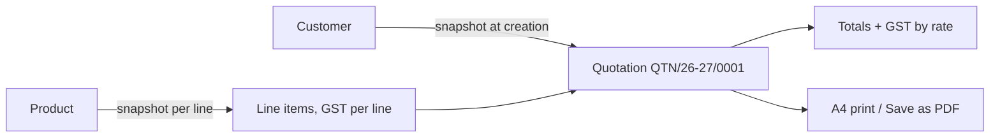

Invoxa is a quotation and billing tool for one small business in India. The shop owner keeps customers and products, writes quotations, and prints them on A4 with their own letterhead. It is deliberately not an accounting system: no ledgers, no payment tracking, and no full GST invoice compliance.

The interface, quotation workflow and calculations are built and tested against sample data. The PostgreSQL schema is designed and documented, and connecting it with Drizzle on Neon is the next step, followed by invoices.

## How It Works

- GST lives on each line item, never on the quotation as a whole, so one quotation can mix rates. The printed quotation groups taxable amounts and GST by rate.
- Prices are GST-exclusive. Each line's taxable amount, GST and total are rounded to the paisa once, when the line is calculated. Document totals are plain sums of those rounded values, never rounded again. Sums are done in whole paise to avoid floating-point drift, and unit tests pin the edge cases, such as half-paise values that binary floats store just under the half.
- Quotation numbers restart every 1 April and carry the financial year. Editing a quotation never changes its number, so its date can only move within that year. Deleting one never frees its number.
- A quotation stores a snapshot of the customer and of each product as they were when it was written, so editing or deleting a customer or product never changes an old quotation.
- The quotation list opens on the current financial year and can switch to earlier years, all years or custom dates. It searches by number or customer, filters to valid or expired quotations, sorts by date or amount, shows the count and total quoted, and keeps its filters when you open a quotation and go back.
- Printing uses one print stylesheet and the browser's own dialog for both paper and Save as PDF, so there is no PDF library. The page carries only the shop's letterhead, with no Invoxa branding.

## Key Highlights

- Per-item GST with a rate-wise breakdown on the printed quotation
- Financial-year quotation numbering that never reuses a number
- Paise-exact money math with unit tests for rounding edge cases
- Snapshots keep old quotations correct after customers or products change
- "Bill book" design with ruled lines, indigo ink on warm paper, and Indian number and date formats
- Public pages are indexed, while the app, sign-in and settings are hidden from search engines

## Tech Stack

- **Next.js** App Router with **React** and **TypeScript**
- **MUI** for components, with **Tailwind CSS** for layout
- **Vitest** for unit tests of the calculations, financial years and the quotation list
