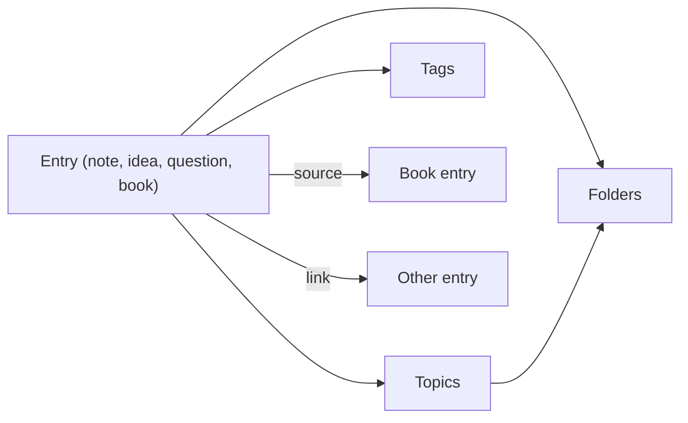

Margin is a place for what you think while reading: notes, ideas, questions and the books they came from. Entries are written in a rich text editor and grouped by folders, topics, books and tags. Sign-in is Google only, and each user's data is private to them.

## How It Works

- Everything is an entry with a type: note, idea, question or book. Books also have an author and a reading status (want to read, reading, finished). An entry can cite books as its sources and link to other entries, and folders, topics and tags are many-to-many, so the same note can sit in several places.
- The editor is Tiptap. Content is stored as Tiptap's JSON in a PostgreSQL `jsonb` column, with a plain-text copy saved alongside it for the previews in entry lists.
- Edits autosave one second after typing stops. After a failed save it waits for the next edit instead of retrying in a loop.
- Server actions are public endpoints, so each one parses its input with Zod and checks every id it receives against the signed-in user before writing. The editor's JSON is checked by hand with a depth limit, so a crafted document cannot make the server recurse without end. Per-account caps on entries and collections keep one account from filling the free database.
- The schema enforces the rules too: check constraints on entry types and reading statuses, unique names per user for folders, topics and tags, and an entry cannot link to itself. Primary keys are UUIDv7 generated by PostgreSQL.
- A session only counts while its user row still exists, so a deleted account cannot keep using an old JWT. Users can export all their data as JSON or delete their account, which cascades to everything they own.

## Key Highlights

- One entry model for notes, ideas, questions and books, with sources and links between entries
- Rich text stored as JSON with a plain-text copy for list previews
- Debounced autosave that does not loop on failure
- Ownership checked on every id in every server action
- Database constraints that back up the app's validation
- JSON export and full account deletion

## Tech Stack

- **Next.js** App Router with server actions
- **NextAuth.js** with Google sign-in
- **PostgreSQL** with **Drizzle ORM** for the schema and migrations
- **Tiptap** for the rich text editor
- **Zod** for input validation
- **Tailwind CSS** and **shadcn/ui** for the interface
