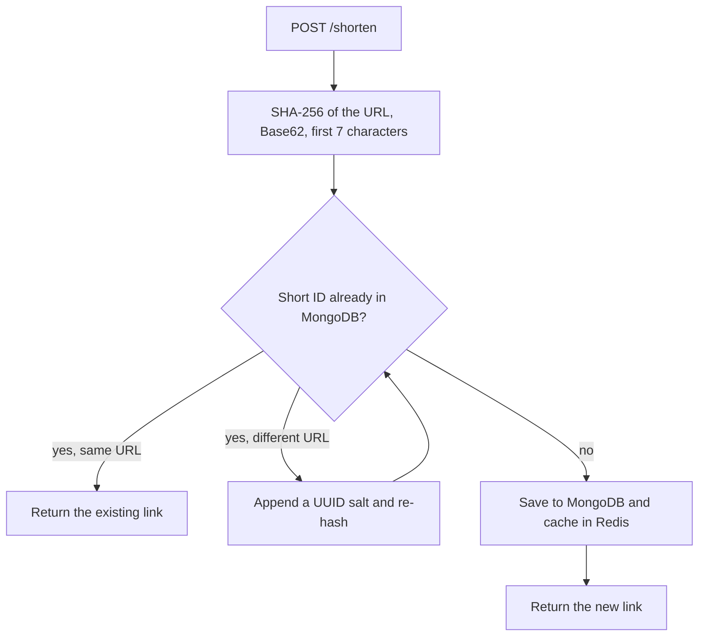
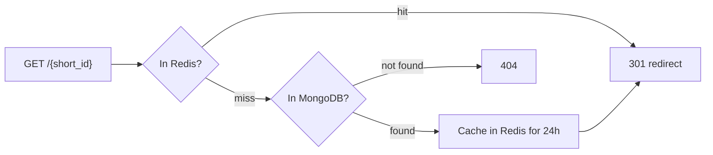

Shortify started as a way to practice backend design beyond basic CRUD, so most of the interesting work happens in how short IDs are generated and how redirects are served.

## How It Works

- A short ID is a SHA-256 hash of the long URL, encoded in Base62 for a compact, URL-safe string. The same long URL always maps to the same short ID, so shortening it twice returns the existing link instead of creating a duplicate.
- If a short ID is already taken by a different URL, a UUID salt is appended and the URL is re-hashed until the ID is free. This keeps generation stateless, with no central counter to coordinate.

- MongoDB stores the URL mappings, with a unique index on the short ID as the final guard against duplicates.
- Redirects follow a cache-aside pattern: Redis is checked first, and on a miss the mapping is read from MongoDB and cached for 24 hours.

- Database calls run through Motor, MongoDB's async driver, so the FastAPI service handles concurrent redirects without blocking.
- The API exposes two endpoints, shorten and redirect, documented automatically through FastAPI's Swagger/OpenAPI support, and Docker Compose runs MongoDB and Redis locally.
- The first version (Nov 2025) used PostgreSQL with SQLAlchemy and had delete and recent-URL endpoints plus a Locust load test. The May 2026 rewrite moved to a MongoDB-first design focused on the shorten and redirect path.

## Key Highlights

- Deterministic short IDs from a SHA-256 hash encoded in Base62
- Collision handling by salting and re-hashing, with no central counter
- Same long URL always returns the same short link
- Cache-aside Redis layer in front of MongoDB with a 24-hour TTL
- Unique index on the short ID enforced in MongoDB
- Async database access with Motor (MongoDB async driver)
- Docker Compose setup for MongoDB and Redis

## Tech Stack

- **FastAPI** for async request handling and automatic API docs
- **MongoDB** for URL storage, with a unique index on the short ID
- **Redis** as a cache-aside layer for hot redirects
- **Docker Compose** for the local MongoDB and Redis services
