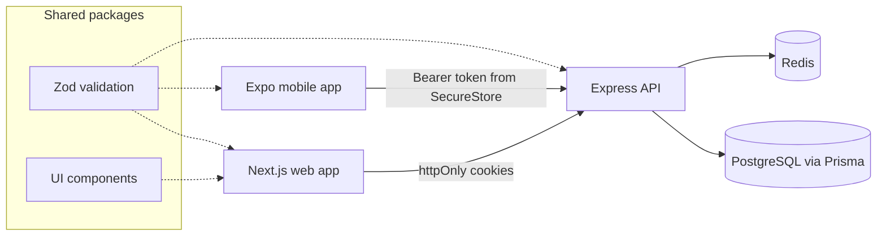
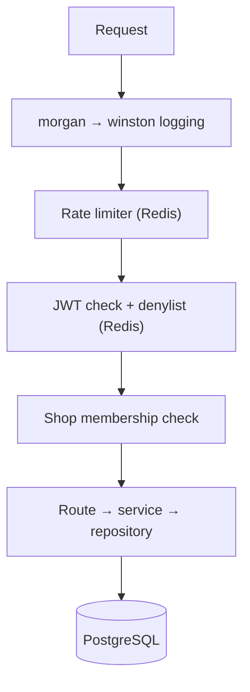
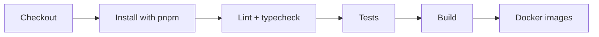

A tailoring business management system built for a family member's tailoring shop, and a personal experiment in running a monorepo across a web app, a mobile app, and an API with a single shared codebase for validation and types.

It started in Oct 2025 as two separate repos, a Next.js frontend and an Express backend. In Jun 2026 I moved both into a Turborepo monorepo, carried most of their code over, and added the Expo mobile app.

## How It Works

- A Turborepo + pnpm workspace holds three apps - a Next.js web app, an Expo/React Native mobile app, and an Express API - alongside shared packages for Zod validation schemas and shadcn/Radix UI components.

- The web app authenticates over httpOnly cookies, while the mobile app authenticates with tokens stored in Expo SecureStore, both against the same Express API.
- Prisma models users, shops, and shop membership so a single account can belong to multiple shops with an OWNER or STAFF role, alongside per-shop customers and their measurements. Each customer gets a number scoped to their shop, which is what the shop uses to find them and what appears in URLs.
- The day starts on a Today screen: type a customer's number and press Enter to open them, with shop totals, recent customers and customers still without a sheet. Taking a sheet uses kurta, sherwani and suit presets, moves field to field on Enter, shows last time's value under each field, and parses quarter inches typed as 38.5, 38 1/2 or 38½. A sheet prints as a slip or goes out on WhatsApp, with Gujarati measurement names shown next to the English ones if the shop wants them.
- Every request is logged through morgan into winston and passes a Redis-backed rate limiter. Protected routes then check the JWT and a Redis denylist, so logout, password change and account deletion revoke the current token immediately. Shop routes also check the caller is a member of that shop. Passwords are hashed with bcrypt, and the same Zod schemas validate input on both the API and the clients that consume it. If Redis goes down, customers and sheets keep working and only sign-in asks the user to retry, and the API refuses to start in production with a weak or example JWT secret.

- The API has 320+ tests written with Vitest and Supertest: unit tests for services, middleware, routes and utilities, plus integration tests that run auth, customers and measurements against a real database.
- A Jenkins pipeline runs lint, typecheck, tests, the build, and Docker image builds for the API and web app, with SonarQube used for code-quality analysis.

Turborepo filters each stage to the packages changed since the last commit or the target branch, so a change to one app doesn't rebuild the others.

## Key Highlights

- Designed around the real day-to-day workflow of a family-run tailoring shop
- Multi-shop workspaces with role-based membership (owner/staff)
- Customer management with per-customer measurement records
- Shared validation and type layer across web, mobile, and API
- Cookie-based auth for web, token + SecureStore auth for mobile
- Mobile app built with Expo, covering auth, shops, customers, and measurements
- Today screen, number lookup, fast sheet entry, printed slips and WhatsApp sharing
- Gujarati measurement names alongside English, in a design drawn from Kutch block prints
- 320+ API tests, unit and integration
- Jenkins pipeline for lint, typecheck, tests, build, and Docker images
- Redis-backed rate limiting, structured request logging, and bcrypt password hashing
- Orders, payments, and delivery tracking are still in progress

## Tech Stack

- **Next.js & React** for the web app
- **Expo & React Native** for the mobile app
- **Node.js, Express, Prisma & PostgreSQL** for the API and data layer
- **Redis** for rate limiting and revoking access tokens
- **Zod** for shared validation across every app
- **TanStack Query & Zustand** for data fetching and client state
- **Turborepo & pnpm** to manage the monorepo
- **Vitest & Supertest** for API tests
- **Docker, Jenkins & SonarQube** for builds, CI, and code quality
